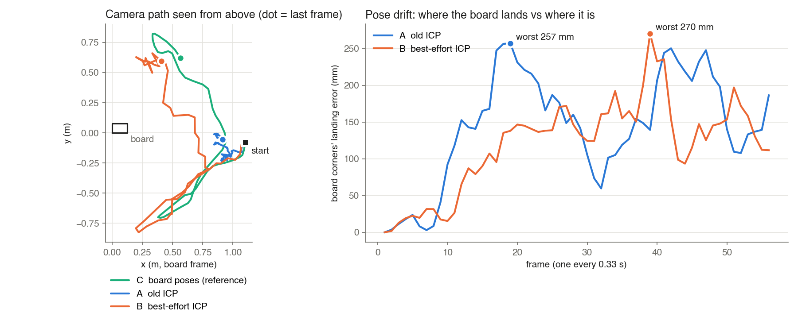
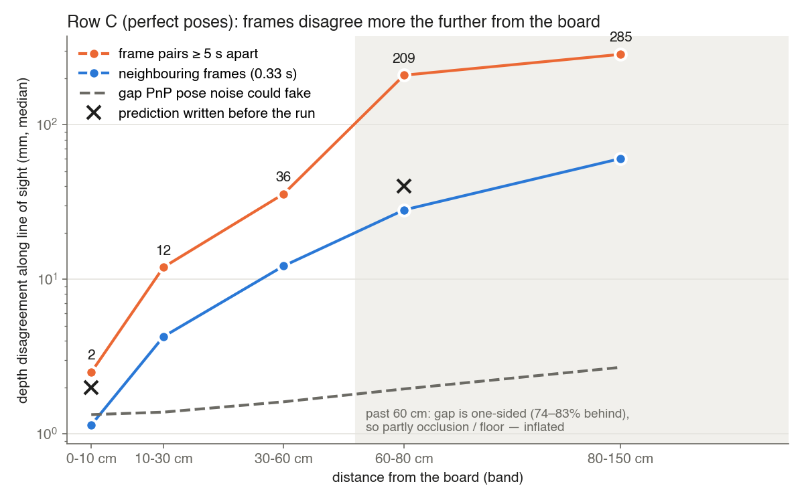

# P1: Why my first reconstruction stacked layers instead of one surface

**TL;DR.** My first prototype estimated depth in each video frame with MiDaS and stacked the frames using ICP. I gave the same approach perfect camera poses: frames still disagree by 2.4 mm at the checkerboard and 30 mm half a metre away, so the desk stacks into layers. Better ICP settings cut early drift (15 vs 92 mm after 3 s) but still lose the board by up to 27 cm. Stacking per-frame depth is the wrong approach, not just badly tuned.

## 1. The question
My first prototype turned a hand-held video into a point cloud in two steps. MiDaS estimated depth in each frame on its own, and ICP lined each frame up with the one before. The result looked like several copies of the desk stacked on top of each other.

Was that because I used the wrong settings, or because the approach itself is wrong? Put another way: can per-frame depth plus ICP stacking ever produce one surface?

## 2. Setup
I filmed a desk with a checkerboard on it (9×6 corners, 15.5 mm squares). I walked a hand-held arc about 1.2 m away for 19.8 s and used every 10th frame: 56 frames, 0.33 s apart. The board is the only object whose size and position I know, so it is the ground truth.

In each frame, MiDaS's depth is scaled to metres using half the board's corners (FIT). The other half (HELD-OUT) checks that fit. The same 56 point clouds are then placed in three ways:

- **A, old ICP:** my prototype's settings. It searches only 2 cm and starts each step from "no movement".
- **B, best-effort ICP:** the best version I could design without using the board. It starts from the previous step's movement, sets its search distances from the data, and narrows them from coarse to fine.
- **C, perfect poses:** the board's pose in every frame. This is the best the approach can ever do.

I score rows A and B by how far the board lands from where it really is. I score row C by how much the frames disagree on the depth of the same point, grouped by distance from the board.

## 3. Result

| Board's landing error | A: old ICP | B: best-effort ICP |
| --- | --- | --- |
| frame 10 (3 s) | 92 mm | 15 mm |
| worst | 257 mm | 270 mm |
| rotation error (median) | 23.7° | 6.5° |

| Distance from board | Frames disagree by (row C) | Gap that pose noise could cause |
| --- | --- | --- |
| 0–10 cm | 2.4 mm | ≤ 1.3 mm |
| 10–30 cm | 11.5 mm | ≤ 1.4 mm |
| 30–60 cm | 30.5 mm | ≤ 1.6 mm |

With perfect poses (row C), the frames agree near the board and disagree more the further out you go. At 30–60 cm the gap is about 20 times what pose noise could cause, so it comes from the depth. Frames far apart in time disagree about 3 times more than neighbouring frames (36 vs 12 mm at 30–60 cm). Past 60 cm the gap is larger still, but occlusion and the floor partly cause it, so I don't rely on those bands.

Best-effort ICP (row B) follows the shape of the walk and cuts the early error. But it zig-zags and ends up just as lost as the old version.

## 4. Why it happens
**Pose drift comes from ICP.** ICP lines up two clouds in a loop:

1. Pair each point with its nearest neighbour within a search distance.
2. Shift the cloud to close those gaps.

My old version started every step from "no movement" and searched only 2 cm. Because I used every 10th frame, the camera really moved a median of 5.7 cm per step, but ICP measured 2.4 cm. The true partners were out of reach, so ICP paired points with the wrong neighbours and stopped short. Each step builds on the last, with nothing to correct it, so the shortfalls add up.

- **Turning counts as well as walking.** At about 1 m away, turning the camera 1° shifts the desk points about 1.7 cm. So a 3° turn alone moves things about 5 cm, past the search distance.
- **The flat desk makes it worse.** A flat surface lines up with itself however you slide it along the plane, so nothing stops ICP sliding the wrong way.

**Layering comes from MiDaS.** MiDaS gives each frame a relative depth map with an unknown scale and shift, which I fit on the board. That pins every frame's depth at the board, and nowhere else. Away from the board, each frame's small scale error grows with distance. MiDaS also gets the shape slightly different from each viewpoint. So even with perfect poses, the same desk lands at different depths in different frames: 2.4 mm apart at the board, 30 mm apart 30–60 cm away.

**Possibly linked (inferred, untested):** neighbouring clouds already disagree by 4–12 mm at 10–60 cm from the board. So even well-tuned ICP has no exact match to find, which may be why row B still drifts.

## 5. Proven / claimed / inferred
- **Measured:**
  - With perfect poses, frames disagree by 2.4, 11.5 and 30.5 mm at 0–10, 10–30 and 30–60 cm from the board. Pose noise explains at most 1.6 mm of that.
  - Old ICP measured 2.4 cm per step against a real 5.7 cm, and 47 of 55 steps were over its 2 cm search.
- **Claimed (from papers):** MiDaS is trained to ignore scale and shift, so its output is only relative inverse depth (Ranftl et al., 2022).
- **Inferred:**
  - Part of the gap comes from MiDaS getting the shape wrong, not just the scale, because the gap is larger than my scale-only prediction.
  - Depth disagreement may be part of why even best-effort ICP drifts.
  - Neither of these has been tested directly.

## 6. Limitations
- One scene and one hand-held video, about 1.2 m from the desk.
- Row B's search settings are sensible defaults, not tuned: a 2.5× margin, 0.5 m/s and 30°/s. Row B also got two kinds of help from the board that a real system wouldn't have: correct metric scale, and a 1.5 m crop around the board.
- Past 60 cm, occlusion and the floor inflate row C's gap, so I only rely on 0–60 cm.
- My first calibration had a focal length 11% short; the per-step ICP numbers in §4 used it. This experiment uses a better tripod calibration (0.44 px error).

## 7. What it changed
Even with perfect poses, per-frame depth doesn't agree between frames, so no ICP setting can fix the stacking. The next step moves away from relative depth estimated one frame at a time. Instead I'll use methods that estimate depth and camera pose across many frames together, so the views agree by construction. P2 compares two of them: VGGT (learned) and COLMAP (classic structure-from-motion).

## Appendix: paper notes
These notes are tidied from my Reconstructor sketch (26 Oct). I've kept only what bears on P1: how single-frame models behave as the camera moves. The notes on R2S2R, WMPO, PhysTwin and Phys2Real are about simulation and policy, so they belong to later checkpoints.

**MiDaS (Ranftl et al., 2022; Birkl et al., 2023).**
- Trained across many datasets with a loss that ignores scale and shift, so its output is relative inverse depth.
- That training is what makes it robust across scenes. It is also why every frame needs its own scale and shift, and why frames disagree away from where that fit is pinned (§4).

**MonoDiff9D: single-image object pose by diffusion.**
- **Benchmark vs the wild.** It scores well on the CAMERA25 and REAL275 benchmarks but drops sharply on Wild6D: 3D50 = 9.6%, 10°10cm = 11.1%. These are pass rates, not average errors: only 9.6% of predictions reach 50% 3D overlap.
- **Depth is the bottleneck.** The paper reports roughly 10–20 cm error from its DINOv2 depth.
- **Still single-image.** The diffusion timesteps are noise levels, not video frames. Nothing ties one frame's answer to the next.
- **My inference:** run frame by frame, it would jitter and give inconsistent geometry. That's the same failure P1 measures with MiDaS.
- **Camera pose is missing.** Even perfect per-camera object poses don't give a consistent scene unless the camera's motion is estimated and tied in too.

**6D-Diff: diffusion over 2D keypoints, then PnP.**
- 6D-Diff diffuses keypoints and leaves the final pose to geometry (PnP). MonoDiff9D outputs the pose directly, so nothing geometric checks the answer.
- My inference: that missing check may be part of why MonoDiff9D falls apart on Wild6D.
- P1 shows the same split. The board's pose, solved geometrically by PnP, is accurate to 0.08°. MiDaS depth, with nothing checking it across frames, isn't.

**The question these notes leave for P2.** Can noisy single-frame predictions be combined across frames into one geometry that's more accurate than any single frame? P1 says per-frame fitting and stacking can't do it. VGGT (Wang et al., 2025) and COLMAP (Schönberger and Frahm, 2016) both solve depth and pose jointly across views. That's what P2 compares.

**References**
- Besl, P. J. and McKay, N. D. (1992). A Method for Registration of 3-D Shapes. *IEEE TPAMI* 14(2).
- Birkl, R., Wofk, D. and Müller, M. (2023). MiDaS v3.1: A Model Zoo for Robust Monocular Relative Depth Estimation. arXiv:2307.14460.
- Chen, Y. and Medioni, G. (1992). Object Modelling by Registration of Multiple Range Images. *Image and Vision Computing* 10(3).
- MonoDiff9D: Monocular Category-Level 9D Object Pose Estimation via Diffusion Model (2025). *[check authors and venue]*
- Ranftl, R., Lasinger, K., Hafner, D., Schindler, K. and Koltun, V. (2022). Towards Robust Monocular Depth Estimation: Mixing Datasets for Zero-shot Cross-dataset Transfer. *IEEE TPAMI* 44(3).
- Schönberger, J. L. and Frahm, J.-M. (2016). Structure-from-Motion Revisited. *CVPR*.
- Wang, J., Chen, M., Karaev, N., Vedaldi, A., Rupprecht, C. and Novotny, D. (2025). VGGT: Visual Geometry Grounded Transformer. *CVPR*.
- Xu, L., Qu, H., Cai, Y. and Liu, J. (2024). 6D-Diff: A Keypoint Diffusion Framework for 6D Object Pose Estimation. *CVPR*.
