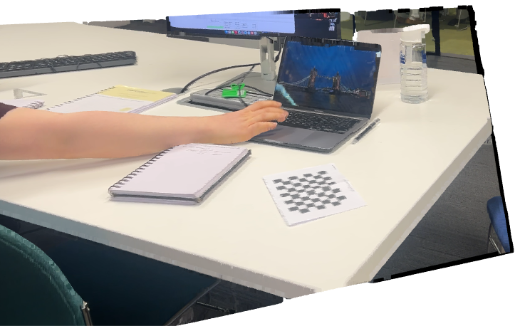

# Image-recon (MiDaS): live desk at ~1 m — 28 Oct 2026

**Goal:** see the fixed pipeline on a real scene, live through Main.py.
**Setup:** phone on a stand ~1 m from a desk (laptop, monitor, notebooks, water bottle); board flat on the desk. One capture. K from calibration attempt B (weak); board 15.5 mm; 2 mm voxels.
**Frame:** `captures/photos/image-recon_midas_2026-10-28_154654_capture01_desk-1m.jpg`

## Numbers
| | |
| --- | --- |
| Board distance | 0.98–1.10 m (well tilted) |
| Depth fit error on board | **4.3 mm** (vs 0.4 mm at 0.36 m) |
| Points after cleanup | **753,967** |
| Board detection check (synthetic, before the run) | found at 0.8 / 1.0 / 1.3 m × 30° / 50° / 65° tilt — 9/9 |

## What we saw (Marv)
- From near the camera's angle, the reconstruction looks right.
- Orbiting it, **the desk surface looked flat** (desk edges not checked closely).
- From other angles or zoomed in, **objects aren't completed**: one view gives a surface over what the camera saw (2.5D), with nothing behind the laptop, bottle or mug. → the first thing to test after MiDaS in checkpoint 1.

## Problems in the run
- Two earlier captures were skipped: the board wasn't in frame.
- The iPhone dropped out right after the capture, and Ctrl+C lost the cloud: it was only saved at ESC. **Fixed:** each capture is now saved before rendering.
- Possible cause of the dropout (not confirmed): frame reading paused for several seconds while 754k points were processed.

## Learned
- Fit error grows with distance (0.4 mm at 0.36 m → 4.3 mm at ~1 m), as you'd expect with ~30 px squares.
- A single view can't complete objects, however good the depth — completion needs more views or a learned prior.
