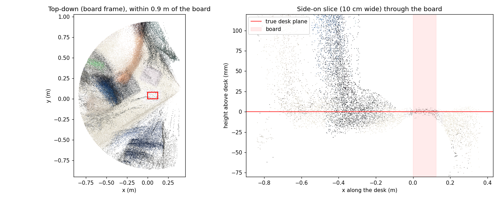

# Video-recon (MiDaS): desk video 1 — 28 Oct 2026

**Goal:** stack many MiDaS frames from one video and see (a) how much more of each object fills in, and (b) how well frames agree with each other.
**Data:** `captures/videos/video_2026-10-28_162722.mp4` — 19.8 s, 593 frames, hand-held, walking a ~90° arc around the desk, board flat on the desk and in view throughout.
**Output:** `captures/ply/video-recon_midas_2026-10-28_162809_from-video_2026-10-28_162722.ply`
**Setup:** every 10th frame; board pose + per-frame scale/shift fit; **no ICP**. K from calibration attempt B (weak); 15.5 mm board; 2 mm voxels.

## Numbers
| | |
| --- | --- |
| Frames checked / used / skipped | 60 / **56** / 4 (board at the frame edge, ~16–18 s) |
| Board distance | 0.70–1.13 m |
| Depth fit error on board, per frame | median **3.2 mm** (1.3–5.2) |
| Points | **16.5 million (446 MB)** |
| Point distance from board | median 1.11 m · 90% 3.21 m · 99% 7.5 m · max 10.2 m (only 42% within 1 m) |
| Run time | ~11 min (≈12 s per used frame, including re-saving the growing file each frame) |

**Desk "sheet" thickness** (points within ±5 cm of the desk plane; a perfect desk is 0 mm):

| Distance from board | Points | Median off-plane | 90% off-plane | Thickness (IQR) |
| --- | --- | --- | --- | --- |
| 0–10 cm | 42k | 2.9 mm | 9.5 mm | **6 mm** |
| 10–20 cm | 251k | 10.0 mm | 28.3 mm | 17 mm |
| 20–30 cm | 386k | 11.5 mm | 28.3 mm | 22 mm |
| 30–45 cm | 765k | 15.0 mm | 38.0 mm | 28 mm |
| 45–60 cm | 765k | 21.2 mm | 42.4 mm | **38 mm** |
| 60–80 cm | 925k | 21.0 mm | 41.4 mm | 39 mm |

## Learned
- **Frames agree at the board and drift apart away from it.** Each frame's scale and shift are pinned on the board, but MiDaS's shape errors differ frame to frame, so the desk thickens from 6 mm to ~38 mm within 60 cm. This is the per-frame inconsistency that multi-view models (VGGT-class) are meant to remove.
- **Far-away points dominate the cloud.** 58% are >1 m from the board, out to 10 m (floor, walls, extrapolated the most). They're also why 2 mm voxels barely shrank the cloud.
- **Moving things smear.** The arm moved during the video and shows up as a ghost across the desk. A static-scene method can't handle that.

## Caveats
- Thickness is measured only within ±5 cm of the plane, so stray points beyond that aren't counted. Objects on the desk (notebook ~1–2 cm thick, laptop base) add some height in the 10–60 cm rings.
- The desk ends ~20 cm to the right of the board, so the drop on that side of the slice is partly the desk edge.
- The calibration is still the weak one (RMS 1.66 px). A better K should help the pose part, not MiDaS's per-frame shape.

## Next
- Same video after the tripod recalibration → isolates how much of the thickness is calibration and how much is MiDaS.
- Crop points beyond ~1.5 m and save every N frames, so runs are faster and files smaller.
- Find a better point-cloud viewer: Open3D's basic window has limiting controls (Marv). Candidates: CloudCompare (free desktop app; measure, slice, compare clouds), Open3D's newer `o3d.visualization.draw()` GUI, Rerun.
