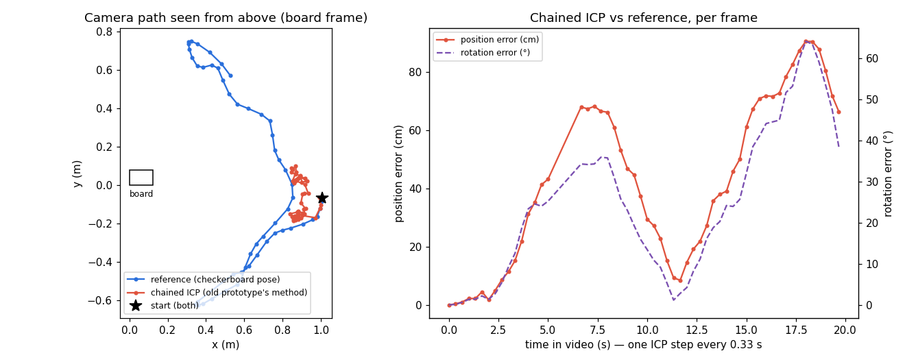

# Video-recon (MiDaS): chained ICP vs reference poses — 15 Nov 2026

**Goal (P1's question):** the old prototype aligned frames with ICP. Was pose drift the real problem, or the depth?
**Data:** desk video 1 (`video_2026-10-28_162722.mp4`, 19.8 s), every 10th frame → **56 frames** with the whole board, one every 0.33 s.
**Code:** `Virtual_space_constructor/per_frame_stack_relative_inverse_depth/icp_drift_probe.py`. Calibration: attempt B (same as desk video 1). 1 cm points, within 1.5 m of the board.
**Reference pose:** the checkerboard's pose in each frame (solvePnP). **ICP:** frame-to-frame, chained, with the old prototype's settings (point-to-point, 2 cm, starting from "no motion"), anchored to the reference at frame 1.
**Data file:** `report_notes/experiments/data/p1_icp-drift_video_2026-10-28_162722_poses.csv`

## Pose: chained ICP vs reference
| Frame (time) | Position error | Rotation error |
| --- | --- | --- |
| 1 (0 s) | 0 (anchored) | 0° |
| 2 (0.3 s) | 3.5 mm | 0.1° |
| 5 (1.3 s) | 22 mm | 1.4° |
| 10 (3.0 s) | **114 mm** | 9.2° |
| 20 (7.7 s) | 665 mm | 36.0° |
| 51 (18.0 s) — worst | **905 mm** | **64.2°** |
| 56 (19.7 s) — last | 664 mm | 38.5° |

| | Reference | Chained ICP |
| --- | --- | --- |
| Camera path length | 3.09 m | 1.51 m |
| Area the path covers (x × y) | 0.70 × 1.38 m | 0.17 × 0.29 m |

| Per step (0.33 s apart) | |
| --- | --- |
| Real camera movement | median **5.7 cm** (0.2–23.6 cm); **47 of 55** steps over ICP's 2 cm search |
| ICP's estimate | median **2.4 cm** |

ICP effectively decides the camera barely moved: its path stays in a small cluster near the start while the real camera walks an arc around the desk. Each step starts from "no motion" and only looks 2 cm for matches, so it under-counts every move, and the shortfalls add up.

## Depth: desk thickness with each set of poses
Points within ±5 cm of the desk plane; thickness = middle 50% of heights (IQR). 0 mm = perfect.

| Distance from board | Reference poses | ICP poses |
| --- | --- | --- |
| 0–10 cm | **3.4 mm** | 9.8 mm |
| 10–20 cm | 11.2 mm | 10.5 mm |
| 20–30 cm | 17.7 mm | 15.0 mm |
| 30–45 cm | 23.6 mm | 25.9 mm |
| 45–60 cm | **45.9 mm** | 41.5 mm |
| 60–80 cm | 41.3 mm | 42.9 mm |

## Learned
- **Two separate failures, both real.** (1) Chained ICP drifts badly: 11 cm within 3 s, up to 90 cm and 64°. (2) With *perfect* poses, MiDaS depth still stacks the desk into a slab 3 mm thick at the board and ~45 mm thick half a metre away. Fixing either alone isn't enough.
- **They show up in different places.** ICP on a mostly flat desk goes wrong by sliding and turning *along* the desk, which leaves heights unchanged. So the desk thickness is about the same with either set of poses, and drift shows up as misplaced, ghosted objects instead.
- Thickness numbers differ a little from [desk video 1](2026-10-28_video-recon_midas_desk-video-1.md) (6 → 38 mm) because this probe uses 1 cm points, a 1.5 m crop and no outlier removal. The trend is the same.

## Caveats
- One scene, one hand-held video. Board poses aren't ground truth, though at ~1 m their error is millimetres, far below ICP's centimetres.
- The old prototype's ICP settings, on purpose. Point-to-plane ICP, a motion guess or a bigger search distance would drift less; the point is what the old pipeline did.
- Attempt B calibration (fx 11% short), the same as desk video 1, so the two compare like for like.
