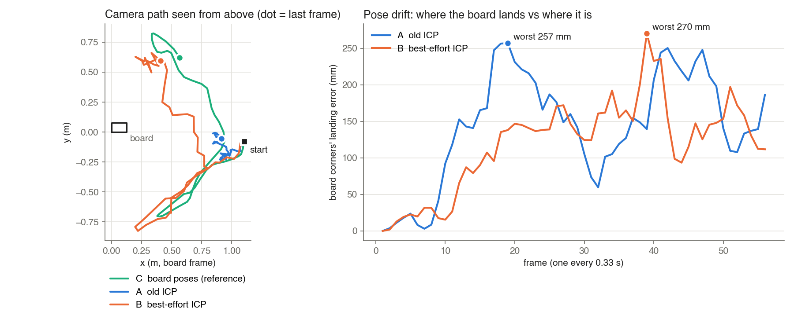
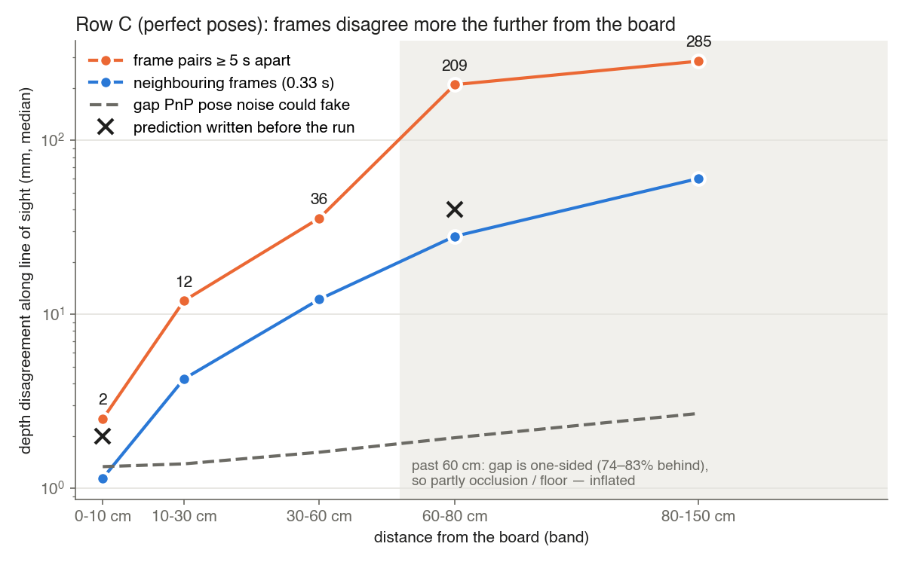

# Video-recon (MiDaS): P1 baseline, three pose sources — 15 Nov 2026

**Aim:** is per-frame depth + ICP stacking the wrong approach, even at its fairest?
**Data:** desk video 1 (`video_2026-10-28_162722.mp4`), every 10th frame → **56 frames**, 0.33 s apart. Median depth 1.2 m.
**Code:** `Virtual_space_constructor/p1_baseline_experiment.py`. Calibration **C** (tripod, 0.44 px). Design: [flowchart](../Stage%20Reports/figures/P1_experiment-design.png).
**Data files:** `data/p1_baseline_video_2026-10-28_162722_poses.csv`, `data/p1_baseline_video_2026-10-28_162722_rowC_gap.csv`

| Row | Poses from | Settings |
| --- | --- | --- |
| A | old ICP | fixed 2 cm search, start from "no movement", point-to-point |
| B | best-effort ICP, no board info | motion guess = last step; coarse search d₀ = 2.5 × (last move + Z_med × last turn), first step 0.5 m/s + 30°/s; fine = max(1 cm, 3σ_depth) = 1.4 cm; halve to fine, point-to-plane |
| C | board pose every frame | the ceiling |

Depth fit on **FIT** corners only (every other row). Depth error: FIT 2.3 mm, **HELD-OUT 2.7 mm** (median), so the fit doesn't overfit.

## Pose drift (rows A, B): board corners' landing error
| Frame | Row A | Row B |
| --- | --- | --- |
| 2 | 3.7 mm | 1.9 mm |
| 5 | 23.7 mm | 22.5 mm |
| 10 | 92.3 mm | **15.4 mm** |
| 56 (last) | 186 mm | 112 mm |
| median / worst | 146 / **257 mm** | 136 / **270 mm** |
| rotation error, median | 23.7° | 6.5° |

| Camera path | A | B | C (true) |
| --- | --- | --- | --- |
| length | 1.50 m | 4.39 m | 3.42 m |
| area (x × y) | 0.26 × 0.24 m | 0.91 × 1.49 m | 0.77 × 1.53 m |

Row B follows the shape of the walk (A barely moves), but it zig-zags (path 28% too long) and still loses the board by 10–27 cm after ~10 s.

## Layering (row C): depth disagreement between frames along the line of sight
Perfect poses, so any gap is depth. Median over 1540 frame pairs.

| From board | All pairs | Neighbours (0.33 s) | ≥ 5 s apart | PnP noise could fake | Predicted |
| --- | --- | --- | --- | --- | --- |
| 0–10 cm | **2.4 mm** | 1.1 | 2.5 | 1.3 | ~2 |
| 10–30 cm | 11.5 | 4.3 | 11.9 | 1.4 | |
| 30–60 cm | **30.5** | 12.2 | 35.7 | 1.6 | |
| 60–80 cm* | 142 | 28.1 | 209 | 1.9 | ~40 |
| 80–150 cm* | 204 | 60.3 | 285 | 2.7 | |

*Past 60 cm the gap is one-sided (74–83% of points sit behind the other frame's surface) and 20–28% of points are below the desk plane: occlusion and floor inflate these bands. Read 0–60 cm as the clean evidence.

PnP noise (upper bound, from 537 consecutive-frame triples): 0.083° rotation, 0.94 mm position.

Desk thickness (IQR, mm; assumes a flat desk; 0–10 / 10–30 / 30–60 / 60–80 cm): A 10.5 / 14.7 / 26.8 / 46.2 · B 7.5 / 12.1 / 25.2 / 51.4 · C 3.1 / 11.1 / 29.8 / 38.3.

## Learned
- **The approach fails at its ceiling.** With perfect poses, frames agree at the board (2.4 mm) and disagree 12× more by 30–60 cm (30 mm). That's 10–20× the gap pose noise could explain. Stacking per-frame depth makes layers by construction.
- **Bigger than the scale-error prediction.** Predicted ~2 → ~40 mm; measured 2 → 30 mm by 45 cm and far more beyond. MiDaS's shape errors add on top of the per-frame scale error: no per-frame fit fixes that.
- **Frames far apart disagree more** (36 vs 12 mm at 30–60 cm). Neighbouring frames share errors, so stacking a short burst hides the problem.
- **Better ICP settings help, but don't fix it.** B beats A early (15 vs 92 mm at frame 10) and on rotation (6.5° vs 23.7°), but ends up just as lost (worst 270 vs 257 mm). And B had help a real system wouldn't: correct metric scale and a 1.5 m crop around the board, both from the board.
- So the old failure was **partly bad settings, mostly the approach**. Next: multi-view-consistent depth and pose (P2: VGGT vs COLMAP).

## Caveats
- One scene, one hand-held video. Row B's k, v, ω are design defaults, not tuned.
- Row C's gaps are pairwise medians, so occluded points aren't removed. An occlusion test is the fix if the far bands matter.
- The row A numbers differ from [the 15 Nov ICP probe](2026-11-15_video-recon_midas_icp-drift-vs-reference.md) (calibration B, camera-position error): different calibration and a different measure.
